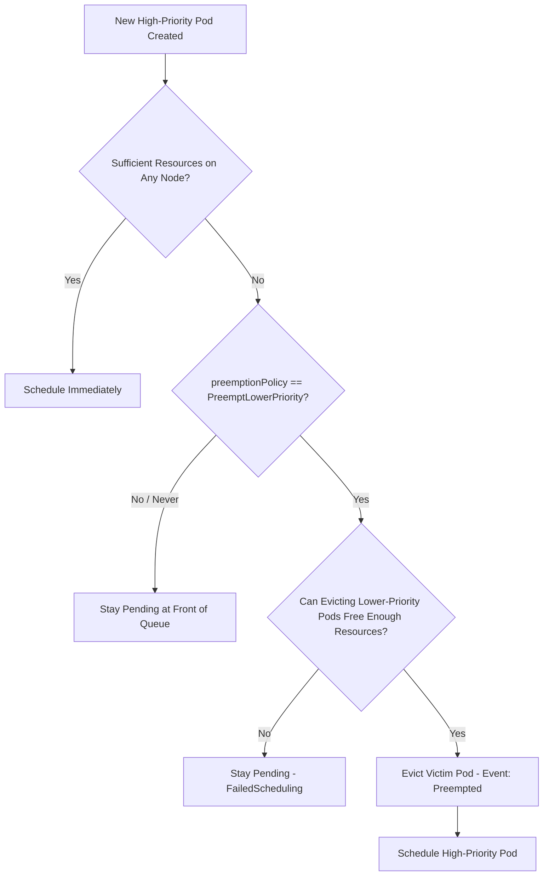

# Kubernetes Priority Scheduling & Preemption — Concept Guide & Live Experiment

This repository provides a complete, hands-on experiment demonstrating **Pod Priority and Preemption** in Kubernetes, along with real `kubectl` outputs, scheduler events, and a detailed conceptual guide.

---

## Table of Contents

1. [What is Priority Scheduling in Kubernetes?](#1-what-is-priority-scheduling-in-kubernetes)
2. [Core Concepts](#2-core-concepts)
   - [PriorityClass](#priorityclass)
   - [Priority Values & Built-in Classes](#priority-values--built-in-classes)
   - [How Scheduling Queue Ordering Works](#how-scheduling-queue-ordering-works)
   - [How Preemption Works](#how-preemption-works)
   - [`preemptionPolicy`: `PreemptLowerPriority` vs `Never`](#preemptionpolicy-preemptlowerpriority-vs-never)
3. [Repository Structure](#3-repository-structure)
4. [Experiment Design & Walkthrough](#4-experiment-design--walkthrough)
5. [Observed Results](#5-observed-results)
6. [How to Reproduce](#6-how-to-reproduce)
7. [Production Best Practices & Caveats](#7-production-best-practices--caveats)

---

## 1. What is Priority Scheduling in Kubernetes?

In a shared Kubernetes cluster, not all workloads are equally important. Critical services (such as payment APIs, ingress controllers, or monitoring agents) must be scheduled before best-effort batch jobs or dev workloads.

**Pod Priority and Preemption** solves this at the `kube-scheduler` level:
- **Priority** determines the **order** in which `Pending` pods are placed into the scheduling queue. Higher-priority pods are scheduled first.
- **Preemption** allows `kube-scheduler` to **evict (terminate)** lower-priority `Running` pods on a node when a higher-priority pod cannot be scheduled due to insufficient resources (CPU, memory, etc.).

---

## 2. Core Concepts

### PriorityClass

A `PriorityClass` is a **cluster-scoped** (non-namespaced) object in the `scheduling.k8s.io/v1` API group that maps a human-readable name to an integer priority value.

```yaml
apiVersion: scheduling.k8s.io/v1
kind: PriorityClass
metadata:
  name: demo-high-priority
value: 1000
globalDefault: false
preemptionPolicy: PreemptLowerPriority
description: "High-priority class for mission-critical workloads."
```

Pods reference a `PriorityClass` via `spec.priorityClassName`. The Kubernetes admission controller (`Priority` admission plugin) resolves `priorityClassName` and populates `spec.priority` with the corresponding integer value.

### Priority Values & Built-in Classes

| Priority Range | Purpose |
| :--- | :--- |
| `<= 1,000,000,000` (1 billion) | Available for user-defined `PriorityClass` objects (can also be negative). |
| `> 1,000,000,000` | Reserved for built-in system-critical pods. |

Kubernetes ships with two built-in classes:
- `system-cluster-critical` (`2000000000`) — e.g., CoreDNS, metrics-server
- `system-node-critical` (`2000001000`) — e.g., kube-proxy, static control-plane pods

> **Note:** If a pod does not specify `priorityClassName`, its priority is `0` (unless a `PriorityClass` has `globalDefault: true`). Only **one** `PriorityClass` in a cluster can have `globalDefault: true`.

### How Scheduling Queue Ordering Works

`kube-scheduler` maintains an active scheduling queue sorted by `spec.priority` (descending).
- If two pods are `Pending` and resources become free, the pod with the **higher `priority` value** is popped from the queue and scheduled first — **even if the lower-priority pod was created earlier**.

### How Preemption Works

When a high-priority pod fails normal scheduling (e.g., `Insufficient memory` or `Insufficient cpu`):
1. `kube-scheduler` runs the **PostFilter (Preemption)** plugin.
2. It evaluates candidate nodes where removing one or more **strictly lower-priority** pods would free enough resources for the pending pod.
3. It selects the best node (minimizing the number and priority of victim pods, and respecting `PodDisruptionBudget` on a best-effort basis).
4. It sends a graceful deletion request to the victim pod(s) (emitting a `Preempted` event) and sets `status.nominatedNodeName` on the high-priority pod.
5. Once the victim pod terminates and releases its resources, the high-priority pod is bound to the node.



### `preemptionPolicy`: `PreemptLowerPriority` vs `Never`

| Policy | Queue Priority? | Evicts Lower-Priority Pods? | Ideal Use Case |
| :--- | :---: | :---: | :--- |
| `PreemptLowerPriority` *(default)* | Yes | Yes | Mission-critical services that must run immediately even at the cost of interrupting batch jobs. |
| `Never` | Yes | No | Important data-processing or ML jobs that should jump to the front of the queue without killing in-progress work. |

---

## 3. Repository Structure

```text
k8s-priority-scheduling/
├── README.md                          # Detailed concept guide & experiment report
├── manifests/
│   ├── 01-namespace.yaml              # Dedicated namespace `priority-demo`
│   ├── 02-priority-classes.yaml       # 4 custom PriorityClasses (100, 500, 1000, 1000/Never)
│   ├── 03-low-priority-workload.yaml  # 3-replica Deployment requesting 2Gi memory each
│   ├── 04-high-priority-pod.yaml      # High-priority pod (PreemptLowerPriority)
│   └── 05-non-preempting-pod.yaml     # High-priority pod (preemptionPolicy: Never)
├── scripts/
│   └── run-experiment.ps1             # Reproducible PowerShell script
└── results/
    ├── 01-cluster-baseline.txt        # Node capacity & allocatable resources
    ├── 02-priority-classes.txt        # Registered PriorityClasses
    ├── 03-low-priority-running.txt    # Low-priority pods saturating node memory (89%)
    ├── 04-preemption-events.txt       # Live Preempted & Scheduled events
    ├── 05-non-preempting-test.txt     # Live preemptionPolicy=Never event
    ├── 06-queue-ordering-test.txt     # Proof of priority queue ordering
    └── observations.md                # Structured summary of findings
```

---

## 4. Experiment Design & Walkthrough

The experiment was executed on a local **Docker Desktop Kubernetes (`v1.36.1`)** cluster (`desktop-control-plane`, `7.61 GiB` allocatable memory, `~6.8 GiB` free at baseline):

1. **Create PriorityClasses:** Defined `demo-low-priority` (`100`), `demo-medium-priority` (`500`), `demo-high-priority` (`1000`, `PreemptLowerPriority`), and `demo-high-priority-non-preempting` (`1000`, `Never`).
2. **Saturate Node Memory:** Deployed `low-priority-workload` (3 replicas × `2Gi` memory request = `6Gi`), bringing total node memory requests to **89% (`6946Mi`)** and leaving only `~846Mi` free.
3. **Trigger Preemption:** Deployed `high-priority-critical-pod` (`2Gi` memory, priority `1000`, `PreemptLowerPriority`).
4. **Verify Non-Preempting Policy:** Deployed `high-priority-non-preempting-pod` (`2Gi` memory, priority `1000`, `Never`).
5. **Verify Queue Ordering:** Deleted `high-priority-critical-pod` to free `2Gi` memory while both a `Pending` low-priority pod (`100`, queued earlier) and a `Pending` high-priority non-preempting pod (`1000`, queued later) were waiting.

---

## 5. Observed Results

### Phase 1 — Preemption in Action ([04-preemption-events.txt](results/04-preemption-events.txt))
When `high-priority-critical-pod` (`2Gi`, priority `1000`) was submitted:
- `kube-scheduler` first recorded `FailedScheduling: 0/1 nodes are available: 1 Insufficient memory.`
- It immediately **preempted** `low-priority-workload-79b49d9fb4-l86jf` (`Priority: 100`):
  ```text
  Normal  Preempted  pod/low-priority-workload-79b49d9fb4-l86jf  Preempted by pod ec974bf3-a950-4e72-ae3f-e3eaa5611d1f on node desktop-control-plane
  Normal  Scheduled  pod/high-priority-critical-pod              Successfully assigned priority-demo/high-priority-critical-pod to desktop-control-plane
  ```
- The Deployment's ReplicaSet created a replacement pod (`low-priority-workload-79b49d9fb4-v722g`), which remained `Pending` due to insufficient memory.

### Phase 2 — `preemptionPolicy: Never` ([05-non-preempting-test.txt](results/05-non-preempting-test.txt))
When `high-priority-non-preempting-pod` (`2Gi`, priority `1000`, `Never`) was submitted:
- Even though two lower-priority (`100`) pods were still running, **neither was evicted**.
- The scheduler emitted:
  ```text
  Warning  FailedScheduling  pod/high-priority-non-preempting-pod  0/1 nodes are available: 1 Insufficient memory. no new claims to deallocate, preemption: not eligible due to preemptionPolicy=Never.
  ```

### Phase 3 — Priority Queue Ordering ([06-queue-ordering-test.txt](results/06-queue-ordering-test.txt))
When `high-priority-critical-pod` was deleted (freeing `2Gi` memory):
- `high-priority-non-preempting-pod` (`Priority: 1000`, queued **second**) jumped ahead of `low-priority-workload-79b49d9fb4-v722g` (`Priority: 100`, queued **first**) and immediately transitioned to `Running`.
- `low-priority-workload-79b49d9fb4-v722g` remained `Pending`.

---

## 6. How to Reproduce

### Prerequisites
- A running Kubernetes cluster (`Docker Desktop`, `minikube`, `kind`, or any managed cluster)
- `kubectl` configured to point to your cluster

### Run Automatically (PowerShell)
```powershell
.\scripts\run-experiment.ps1
```

### Run Manually (Any OS)
```bash
kubectl apply -f manifests/01-namespace.yaml
kubectl apply -f manifests/02-priority-classes.yaml
kubectl apply -f manifests/03-low-priority-workload.yaml
kubectl rollout status deployment/low-priority-workload -n priority-demo

# Trigger preemption
kubectl apply -f manifests/04-high-priority-pod.yaml
kubectl get events -n priority-demo --sort-by='.lastTimestamp'

# Test preemptionPolicy: Never
kubectl apply -f manifests/05-non-preempting-pod.yaml
kubectl describe pod high-priority-non-preempting-pod -n priority-demo

# Test queue ordering
kubectl delete pod high-priority-critical-pod -n priority-demo
kubectl get pods -n priority-demo

# Clean up
kubectl delete -f manifests/01-namespace.yaml
kubectl delete -f manifests/02-priority-classes.yaml
```

---

## 7. Production Best Practices & Caveats

- **Restrict `PriorityClass` usage with `ResourceQuota`:** Without quotas, any user could assign `high-priority` to their pods and evict other teams' workloads. Use `ResourceQuota` with `scopeSelector` (`PriorityClass`) to limit who can use high-priority classes.
- **Pair with `PodDisruptionBudget` (PDB):** The scheduler tries to respect PDBs during preemption on a *best-effort* basis, though it will still violate a PDB if no other preemption candidate exists.
- **Avoid `globalDefault: true` on high priorities:** If you set a default `PriorityClass`, keep its value low (e.g., `100`) so unspecified workloads don't accidentally preempt critical services.
- **Account for `terminationGracePeriodSeconds`:** Preempted pods still go through graceful shutdown. If a victim pod has a long grace period, the high-priority pod must wait until those resources are released.
- **Use `preemptionPolicy: Never` for batch/ML queues:** Prevents cascading evictions of long-running jobs while still letting urgent jobs run next as soon as capacity frees up.
