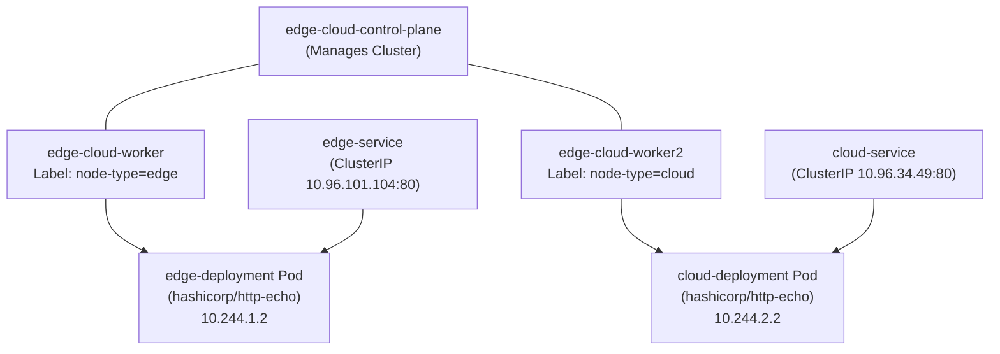
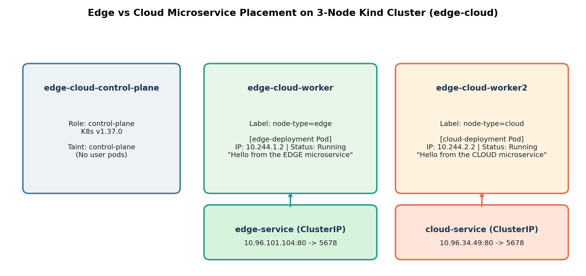
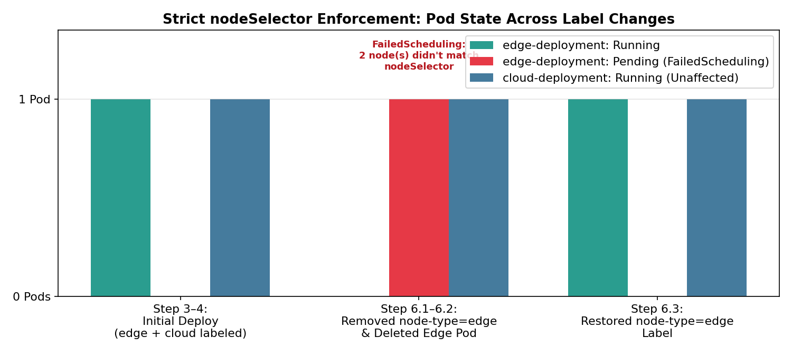

# Mini Lab: Edge vs Cloud Deployment of Microservices on Kubernetes

A hands-on Kubernetes lab demonstrating **Edge vs. Cloud microservice placement** on a 3-node Kind cluster (`edge-cloud`) using **node labels** (`node-type=edge`, `node-type=cloud`) and **`nodeSelector`**, verifying cross-node Service discovery and strict scheduling enforcement.

---

## 1. Concept & Architecture

| Aspect | Edge Node (`node-type=edge`) | Cloud Node (`node-type=cloud`) |
| :--- | :--- | :--- |
| **Where it runs** | Close to sensors / devices (factory, vehicle, shop) | Central data center |
| **Best suited for** | Low-latency reactions, intermittent internet | Heavy analytics, long-term storage, aggregation |
| **Example** | Detecting machine overheating in real time | Storing months of sensor readings & computing trends |



---

## 2. Verified Experiment Results

All live `kubectl` outputs captured during execution on **Kind `v0.33.0` (`Kubernetes v1.37.0`)** are stored in [`results/`](results/):

| Step | Action | Verified Result | Evidence |
| :--- | :--- | :--- | :--- |
| **1. Cluster Creation** | `kind create cluster --name edge-cloud --config kind-config.yaml` | 3-node cluster (`control-plane`, `worker`, `worker2`) created | [01-cluster-nodes.txt](results/01-cluster-nodes.txt) |
| **2. Node Labeling** | `kubectl label node edge-cloud-worker node-type=edge` & `edge-cloud-worker2 node-type=cloud` | `NODE-TYPE` column confirmed `edge` and `cloud` | [02-labeled-nodes.txt](results/02-labeled-nodes.txt) |
| **3–4. Deploy & Verify Placement** | `kubectl apply -f microservices.yaml` & `kubectl get pods -o wide` | `edge-deployment-75494b79b5-xsvgp` landed on **`edge-cloud-worker`** (`10.244.1.2`); `cloud-deployment-745d44b97c-gzpp2` landed on **`edge-cloud-worker2`** (`10.244.2.2`) | [03-deployed-and-placed.txt](results/03-deployed-and-placed.txt) |
| **5. Cross-Node Service Calls** | `curl -s http://edge-service; curl -s http://cloud-service` | Returned `Hello from the EDGE microservice` and `Hello from the CLOUD microservice` | [04-service-calls.txt](results/04-service-calls.txt) |
| **6. Strict `nodeSelector` Demo** | Removed `node-type=edge` label & deleted edge Pod → restored label | Replacement Pod stayed **`Pending`** (`0/3 nodes are available: 1 node(s) had untolerated taint(s), 2 node(s) didn't match Pod's node affinity/selector`); immediately transitioned to **`Running`** on `edge-cloud-worker` once label was restored | [05-node-selector-strict-test.txt](results/05-node-selector-strict-test.txt) |

### Cluster Placement Diagram


### Strict `nodeSelector` Lifecycle (Step 6)


---

## 3. Viva Questions & Answers

1. **What is the difference between an edge node and a cloud node?**
   An **edge node** runs physically close to data sources/users for low-latency, real-time processing even with limited connectivity. A **cloud node** runs in a central data center with large compute/storage capacity for heavy batch analytics and long-term data retention.
2. **What is a label, and what does `nodeSelector` do?**
   A **label** is a key-value tag attached to a Kubernetes object (e.g., `node-type=edge` on a node). **`nodeSelector`** in a Pod spec is a hard scheduling constraint telling `kube-scheduler` to place the Pod *only* on nodes that have all specified labels.
3. **What happened to the pod in Step 6 and why?**
   After removing `node-type=edge` from `edge-cloud-worker` and deleting the edge Pod, the Deployment created a replacement Pod that remained stuck in **`Pending`** with `FailedScheduling: 2 node(s) didn't match Pod's node affinity/selector`. Because `nodeSelector` is strict, Kubernetes refuses to place an edge Pod on a non-edge node; restoring the label immediately allowed it to schedule and run.
4. **Why do we create a Service for each Deployment?**
   Pod IPs are ephemeral and change whenever a Pod is recreated. A **Service** (`edge-service`, `cloud-service`) provides a stable DNS name and virtual `ClusterIP` so microservices can reliably call each other regardless of which node they run on.
5. **Give one example of work better done at the edge and one better done in the cloud.**
   - **Edge:** Real-time industrial sensor anomaly/overheating detection or autonomous vehicle obstacle avoidance.
   - **Cloud:** Training ML models on months of historical fleet/sensor data or generating enterprise-wide analytics dashboards.

---

## 4. Repository Structure & Reproduction

```text
edge-vs-cloud-k8s/
├── README.md
├── kind-config.yaml
├── microservices.yaml
└── results/
    ├── 01-cluster-nodes.txt
    ├── 02-labeled-nodes.txt
    ├── 03-deployed-and-placed.txt
    ├── 04-service-calls.txt
    └── 05-node-selector-strict-test.txt
```

### Quick Start
```powershell
kind create cluster --name edge-cloud --config kind-config.yaml
kubectl label node edge-cloud-worker node-type=edge
kubectl label node edge-cloud-worker2 node-type=cloud
kubectl apply -f microservices.yaml
kubectl get pods -o wide
kubectl run curl-test --rm -it --image=curlimages/curl --restart=Never -- sh -c 'curl -s http://edge-service; curl -s http://cloud-service'
kind delete cluster --name edge-cloud
```
