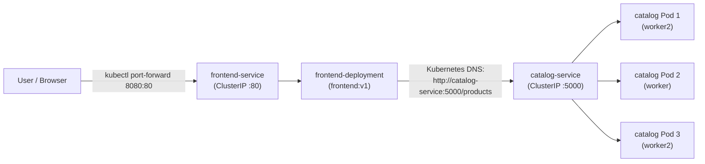

# Cloud Computing Lab — Microservices Web Application & Kubernetes Resource Management

A hands-on Kubernetes & Microservices lab deploying a two-tier Python Flask **Product Management** application (`frontend` + `backend` catalog API) on a **3-node Kind Kubernetes cluster** (`microservices-lab`), demonstrating Docker containerization, Kubernetes DNS service discovery, replica scaling, EndpointSlices, CPU/memory requests & limits, and Pod scheduling.

---

## 1. Architecture



---

## 2. Environment

| Component | Version / Details |
| :--- | :--- |
| **Docker** | `29.9.3` (Docker Desktop) |
| **Kind** | `v0.33.0` (`kindest/node:v1.37.0`) |
| **Cluster Topology** | `1` Control-Plane + `2` Worker Nodes (`microservices-lab`) |
| **Microservice Runtime** | Python `3.11-slim`, Flask, Requests |

---

## 3. Completed Student Observation Sheet (Section 17)

| Observation | Measured / Observed Result |
| :--- | :--- |
| **Name of the Docker backend image** | `catalog:v1` |
| **Name of the Docker frontend image** | `frontend:v1` |
| **Kind cluster name** | `microservices-lab` |
| **Number of Kubernetes nodes** | `3` (`microservices-lab-control-plane`, `microservices-lab-worker`, `microservices-lab-worker2`) |
| **Initial backend replica count** | `1` |
| **Backend replica count after scaling** | `3` |
| **Backend Service name** | `catalog-service` (`ClusterIP: 10.96.223.200`, port `5000`) |
| **Frontend Service name** | `frontend-service` (`ClusterIP: 10.96.180.108`, port `80`) |
| **CPU request configured for backend** | `100m` (limit: `500m`) |
| **Memory request configured for backend** | `128Mi` (limit: `256Mi`) |
| **Reason `resource-test` Pod remained Pending** | `0/3 nodes are available: 1 node(s) had untolerated taint(s), 2 Insufficient cpu, 2 Insufficient memory.` |

---

## 4. Verified Experiment Outputs

All raw `docker`, `kind`, and `kubectl` outputs captured from the live run are stored in [`results/`](results/):

| Phase | Key Verification | Evidence |
| :--- | :--- | :--- |
| **1. Docker Build** | Built `catalog:v1` and `frontend:v1` from `python:3.11-slim` | [01-docker-build.txt](results/01-docker-build.txt) |
| **2. 3-Node Kind Cluster** | All 3 nodes (`control-plane`, `worker`, `worker2`) `Ready` on `v1.37.0`; both images loaded | [02-kind-cluster-and-nodes.txt](results/02-kind-cluster-and-nodes.txt) |
| **3. Deploy & DNS Discovery** | `catalog-service` resolved via Kubernetes DNS to `10.96.223.200`; live call to `/products` returned `{"products":["Laptop","Mobile","Keyboard"],"served_by":"catalog-deployment-69974d8df6-w9rnp"}` | [03-deploy-and-dns.txt](results/03-deploy-and-dns.txt) |
| **4. Scaling to 3 Replicas** | 3 backend Pods scheduled across both worker nodes (`10.244.2.2`, `10.244.1.3`, `10.244.2.3`) and automatically registered in `EndpointSlices` | [04-scaling-and-load-balancing.txt](results/04-scaling-and-load-balancing.txt) |
| **5. Resource Allocation & Scheduling** | Confirmed `Requests (100m CPU, 128Mi RAM)` & `Limits (500m CPU, 256Mi RAM)`; `resource-test` (`100 CPU`, `100Gi RAM`) remained `Pending` with `FailedScheduling` | [05-resource-allocation-and-scheduling.txt](results/05-resource-allocation-and-scheduling.txt) |
| **6. Final Verification** | Confirmed all 3 nodes, 2 Deployments, 4 Pods, 2 Services, and 3 backend endpoints before cluster cleanup | [06-final-verification.txt](results/06-final-verification.txt) |

---

## 5. Quick Viva Questions & Answers (Section 18)

1. **Why did we create separate frontend and backend microservices?**
   Separating concerns allows each service to be developed, packaged, scaled, and deployed independently (e.g., scaling the backend to 3 replicas without scaling the frontend).
2. **What is the difference between a Docker image and a container?**
   A **Docker image** is a read-only packaged template containing code, runtime, and dependencies (`catalog:v1`). A **container** is a live, running instance created from that image.
3. **What is a Kubernetes Pod?**
   A Pod is the smallest deployable unit in Kubernetes that encapsulates one or more containers sharing the same network namespace (IP address) and storage volumes.
4. **What is the role of a Deployment?**
   A Deployment declaratively manages ReplicaSets and Pods — ensuring the desired number of replicas stay running, supporting scaling, self-healing, and rolling updates.
5. **What is the purpose of `catalog-service`?**
   It provides a stable internal virtual IP (`ClusterIP`) and DNS name (`catalog-service`) that routes traffic to all healthy backend Pods matching `app: catalog`.
6. **How does Kubernetes DNS help service discovery?**
   CoreDNS automatically maps each Service name (`catalog-service`) to its `ClusterIP`, so the frontend can call `http://catalog-service:5000/products` without hardcoding dynamic Pod IPs.
7. **What changed when backend replicas increased from one to three?**
   Kubernetes created two new backend Pods across the worker nodes and automatically added their IPs to the `catalog-service` EndpointSlice so traffic could be distributed across all three Pods.
8. **What is the difference between a CPU request and a CPU limit?**
   A **CPU request** (`100m`) is the guaranteed minimum reserved by the Scheduler when placing a Pod on a node. A **CPU limit** (`500m`) is the maximum CPU the container is allowed to use before being throttled.
9. **Which Kubernetes component selects the node for a new Pod?**
   The **`kube-scheduler`**.
10. **Why did `resource-test` remain in `Pending` state?**
    It requested `100` CPU cores and `100Gi` memory. The control-plane node had an untolerated taint, and neither worker node had sufficient CPU or memory to satisfy the request.

---

## 6. Repository Structure & Reproduction

```text
microservice-project/
├── README.md
├── .gitignore
├── backend/
│   ├── app.py
│   ├── requirements.txt
│   └── Dockerfile
├── frontend/
│   ├── app.py
│   ├── requirements.txt
│   └── Dockerfile
├── kind-config.yaml
├── deployment.yaml
├── resource-test.yaml
└── results/
    ├── 01-docker-build.txt
    ├── 02-kind-cluster-and-nodes.txt
    ├── 03-deploy-and-dns.txt
    ├── 04-scaling-and-load-balancing.txt
    ├── 05-resource-allocation-and-scheduling.txt
    └── 06-final-verification.txt
```

### Quick Start
```powershell
# 1. Build images
docker build -t catalog:v1 .\backend
docker build -t frontend:v1 .\frontend

# 2. Create 3-node Kind cluster & load images
kind create cluster --name microservices-lab --config kind-config.yaml
kind load docker-image catalog:v1 frontend:v1 --name microservices-lab

# 3. Deploy & scale
kubectl apply -f deployment.yaml
kubectl scale deployment catalog-deployment --replicas=3

# 4. Access frontend
kubectl port-forward service/frontend-service 8080:80

# 5. Cleanup
kind delete cluster --name microservices-lab
```
