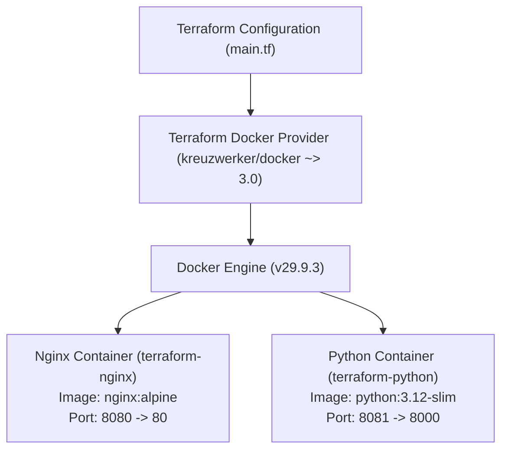

# Terraform Practical — Experiment 1: Deploy Multiple Docker Containers Using Terraform

Provision, deploy, verify, and manage multiple independent Docker containers (**Nginx** on port `8080` and **Python HTTP Server** on port `8081`) using **Terraform** and the `kreuzwerker/docker` provider via Infrastructure as Code (IaC).

---

## 1. Aim & Objectives

- Understand the declarative workflow of **Terraform** (`init`, `validate`, `fmt`, `plan`, `apply`, `destroy`).
- Configure Terraform with the **Docker provider** (`kreuzwerker/docker ~> 3.0`).
- Define multiple `docker_image` and `docker_container` resources with implicit dependency resolution (`image_id`).
- Provision and verify two live containerized applications over HTTP (`localhost:8080` and `localhost:8081`).

---

## 2. Architecture



---

## 3. Environment

| Tool | Version |
| :--- | :--- |
| **Docker** | `29.9.3` (Docker Desktop on Windows) |
| **Terraform** | `1.17.2` (`windows_amd64`) |
| **Docker Provider** | `kreuzwerker/docker` (`~> 3.0`) |

---

## 4. Terraform Configuration ([main.tf](main.tf))

```hcl
terraform {
  required_providers {
    docker = {
      source  = "kreuzwerker/docker"
      version = "~> 3.0"
    }
  }
}

provider "docker" {}

resource "docker_image" "nginx" {
  name = "nginx:alpine"
}

resource "docker_image" "python" {
  name = "python:3.12-slim"
}

resource "docker_container" "webserver" {
  name  = "terraform-nginx"
  image = docker_image.nginx.image_id

  ports {
    internal = 80
    external = 8080
  }
}

resource "docker_container" "python_app" {
  name  = "terraform-python"
  image = docker_image.python.image_id

  command = [
    "python",
    "-m",
    "http.server",
    "8000"
  ]

  ports {
    internal = 8000
    external = 8081
  }
}
```

---

## 5. Experiment Walkthrough & Verified Results

All live command outputs from the run are stored in the [`results/`](results/) directory:

| Step | Command | Result | Evidence |
| :--- | :--- | :--- | :--- |
| **1–2. Verify Tools** | `docker --version`, `terraform --version` | Docker `29.9.3`, Terraform `1.17.2` | [01-versions.txt](results/01-versions.txt) |
| **8–10. Init, Validate & Format** | `terraform init`, `terraform validate`, `terraform fmt` | Provider installed; `Success! The configuration is valid.` | [02-terraform-init-validate-fmt.txt](results/02-terraform-init-validate-fmt.txt) |
| **11. Plan** | `terraform plan` | `Plan: 4 to add, 0 to change, 0 to destroy.` (2 images + 2 containers) | [03-terraform-plan.txt](results/03-terraform-plan.txt) |
| **12. Apply** | `terraform apply -auto-approve` | Created `nginx:alpine`, `python:3.12-slim`, `terraform-nginx`, and `terraform-python` | [04-terraform-apply.txt](results/04-terraform-apply.txt) |
| **13–14. Verify Containers & HTTP** | `docker ps`, `docker images`, HTTP checks | Both containers `Up`; `localhost:8080` returned **HTTP 200** (Nginx welcome page); `localhost:8081` returned **HTTP 200** (Python directory listing) | [05-verify-containers-and-http.txt](results/05-verify-containers-and-http.txt) |
| **Cleanup** | `terraform destroy -auto-approve` | Cleanly tore down all 4 managed resources | [06-terraform-destroy.txt](results/06-terraform-destroy.txt) |

### Container Summary (Verified via `docker ps`)

| Container Name | Docker Image | Internal Port | Host Port | Verification |
| :--- | :--- | :---: | :---: | :---: |
| `terraform-nginx` | `nginx:alpine` | `80` | `8080` | HTTP `200 OK` — Welcome to nginx! |
| `terraform-python` | `python:3.12-slim` | `8000` | `8081` | HTTP `200 OK` — Directory listing for `/` |

---

## 6. Key Observations

1. **Implicit Dependency Graph:** Because `docker_container.webserver` references `docker_image.nginx.image_id` (and `python_app` references `python.image_id`), Terraform automatically pulled the images **before** creating the containers — and destroyed the containers **before** removing the images on `terraform destroy`.
2. **Parallel Provisioning:** Terraform pulled both `nginx:alpine` and `python:3.12-slim` concurrently, then created each container as soon as its respective image finished downloading.
3. **Port Conflict Detection:** When host port `8080` was already bound by another container, Terraform surfaced the Docker Engine bind error cleanly without corrupting state, and resumed cleanly once port `8080` was freed.
4. **State Management:** Terraform tracked all 4 resources in `terraform.tfstate` (excluded from Git via `.gitignore`) so `terraform destroy` removed everything reproducibly.

---

## 7. How to Reproduce

```powershell
# 1. Initialize working directory & download Docker provider
terraform init

# 2. Validate & format configuration
terraform validate
terraform fmt

# 3. Preview execution plan
terraform plan

# 4. Provision containers
terraform apply

# 5. Verify in browser or terminal
#    Nginx:  http://localhost:8080
#    Python: http://localhost:8081
docker ps

# 6. Tear down infrastructure when done
terraform destroy
```

---

## 8. Repository Structure

```text
terraform-multiple-containers/
├── README.md                                  # Concept guide, architecture & verified results
├── main.tf                                    # Terraform configuration (Docker provider + 4 resources)
├── .gitignore                                 # Excludes .terraform/ and *.tfstate*
└── results/
    ├── 01-versions.txt                        # Docker & Terraform versions
    ├── 02-terraform-init-validate-fmt.txt     # init, validate, and fmt outputs
    ├── 03-terraform-plan.txt                  # Full Terraform execution plan
    ├── 04-terraform-apply.txt                 # Live apply output
    ├── 05-verify-containers-and-http.txt      # docker ps, docker images & HTTP 200 checks
    └── 06-terraform-destroy.txt               # Clean teardown output
```
